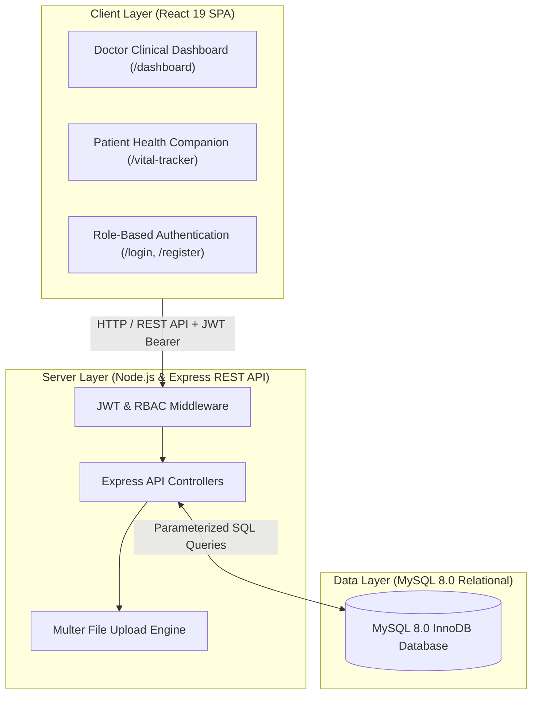

# MedTracker — Clinical Healthcare & Medication Adherence Platform

[](https://react.dev/)
[](https://nodejs.org/)
[](https://expressjs.com/)
[](https://www.mysql.com/)
[](https://jwt.io/)

A full-stack, responsive healthcare web application designed for doctors and patients to collaboratively monitor medication adherence, record vital clinical consultations, visualize treatment compliance analytics, manage diagnostic lab reports, and schedule daily medication alarms.

---

## 💡 The Real-World Problem & Solution

### The Problem
Over 50% of patients with chronic or course-based prescriptions (antibiotics, blood pressure, diabetes medications) fail to adhere to their prescribed regimen. Doctors lack visibility into daily patient behavior between clinical visits, leading to incorrect treatment adjustments and preventable hospital visits.

### The Solution: MedTracker
MedTracker bridges the communication gap with role-segregated portals:
- **Physicians** manage their assigned patient rosters, record clinical consultation notes (presenting complaints & final diagnoses), prescribe medications with validated duration windows, and upload diagnostic lab reports.
- **Patients** access their health companion to view prescriptions, record daily doses with a single tap on an interactive calendar, track compliance velocity via progress bars and Chart.js graphs, and set daily audio reminder alarms.

---

## 🏗️ System Architecture



---

## 🌟 Key Features

### 1. Dual-Role Authentication & Access Control
- Registration and login with role selection: **Doctor** vs. **Patient**.
- Password hashing using salted `bcryptjs` and session tokens powered by `jsonwebtoken` (JWT).
- Role-Based Access Control (RBAC): Doctors cannot mark patient doses; patients cannot prescribe medications or view other patients' charts.
- Protection against Insecure Direct Object References (IDOR): Every query verifies doctor-patient relationships via `doctor_patient_map`.

### 2. Physician Clinical Workspace (`/dashboard`)
- **Patient Roster**: Real-time searchable patient list filtered strictly to patients assigned to the logged-in doctor.
- **Patient Management**: Add new patients, edit demographics (age, sex, weight), and remove patient assignments.
- **Clinical Navigation**: 1-click jump to each patient's Vital Tracker, Lab Reports, or Care-Team Chat.

### 3. Patient Health Companion (`/vital-tracker`)
- **Patient Vitals Card**: Personal summary displaying age, sex, weight, and assigned physician.
- **Consultation Notes**: View doctor-recorded Presenting Complaints and Final Diagnoses.
- **Health Recommendations**: Personalized diet and lifestyle tips posted by the physician.

### 4. Interactive Medication Adherence Calendar
- Monthly calendar grid for each prescribed medication according to its prescription dates.
- **1-Click Dose Toggle**: Patients tap today's date to toggle that dose as taken.
- **Color-Coded Feedback**:
  - 🟢 **Green**: Dose recorded as taken on this date.
  - 🔴 **Red**: Scheduled dose missed in the past.
  - ⚪ **Grey / White**: Future scheduled date (locked against advance tampering).

### 5. Automated Progress Calculation & Chart.js Analytics
- Dynamic adherence calculation executed on the backend:
  $$\text{Adherence \%} = \left(\frac{\text{Total Doses Taken}}{\text{Total Prescribed Days Elapsed}}\right) \times 100$$
- Visual progress bars showing per-medication compliance fractions.
- Interactive **Chart.js** bar/line graphs with toggleable **7-Day** and **30-Day** views showing doses taken vs. doses missed.

### 6. Diagnostic Lab Reports
- Multipart file upload using `multer` supporting medical PDFs, PNGs, and JPEGs up to 15MB.
- Doctors can upload diagnostic lab reports from the dashboard or directly within the vital tracker.
- Built-in preview modal and authenticated file download for both patients and doctors.

### 7. Medication Alarms & Reminders
- Schedule specific daily reminder times (e.g., `08:00 AM`, `08:00 PM`) for each medication.
- In-browser harmonic chime (synthesized using the Web Audio API) paired with an on-screen notification banner.

### 8. Real-Time Care-Team Chat
- Dedicated in-app messaging modal between the patient and their assigned doctor for follow-ups and questions.

---

## 🗄️ Database Schema (11 Relational Tables)

| # | Table Name | Purpose |
| :-: | :--- | :--- |
| **1** | `users` | Primary authentication table storing email, hashed password, and role (`doctor`/`patient`). |
| **2** | `doctor_profiles` | Physician details (full name, qualification, contact info). |
| **3** | `patient_profiles` | Patient demographics (full name, sex, age, weight). |
| **4** | `doctor_patient_map` | Many-to-many relationship mapping assigned doctors to patients. |
| **5** | `appointments` | Consultation records containing appointment dates, complaints, and final diagnoses. |
| **6** | `medications` | Prescribed drug regimens (name, dosage, start date, end date). |
| **7** | `medication_adherence` | Timestamped log of daily medication doses marked as taken. |
| **8** | `health_tips` | Dietary and lifestyle guidance written by doctors for a patient. |
| **9** | `lab_reports` | Server file paths, file names, and upload timestamps for lab documents. |
| **10** | `reminders` | Configured alarm reminder times and notification messages. |
| **11** | `messages` | Chat history between doctors and patients. |

---

## 🚀 Getting Started

### Prerequisites
- **Node.js** (v18 or higher)
- **MySQL Server** (v8.0 or higher)

---

### Step 1: Database Initialization
Open your MySQL terminal or workbench and run the schema setup:

```sql
SOURCE /path/to/Databaseschema.sql;
```

---

### Step 2: Backend Configuration & Startup

```bash
cd backend
npm install
```

Create a `.env` file in the `backend/` directory:

```env
PORT=5000
DB_HOST=localhost
DB_USER=root
DB_PASSWORD=your_mysql_password
DB_NAME=med_tracker
JWT_SECRET=your_secret_jwt_key
```

Start the backend server:

```bash
npm start
# Server running on port 5000
```

---

### Step 3: Frontend Startup

In a second terminal:

```bash
cd frontend
npm install
npm start
# Opens http://localhost:3000
```

---

## 🧪 Demo Test Credentials

To quickly test the application, you can use the pre-seeded accounts:

| Role | Email | Password | Access Portal |
| :--- | :--- | :--- | :--- |
| **Physician** | `dr.alice@hospital.com` | `password123` | `/dashboard` |
| **Patient** | `bob@hospital.com` | `password123` | `/vital-tracker` |

> **Note**: MedTracker includes an embedded database engine with pre-seeded demo records. If MySQL is not running on your machine, the backend automatically activates the local database seamlessly with zero manual database setup required!

---

## 🛡️ Security Implementation
- **SQL Injection Defense**: 100% prepared parameterized SQL queries using `mysql2/promise` placeholders (`?`).
- **BOLA / IDOR Mitigation**: All patient-specific operations verify active linkage in `doctor_patient_map`.
- **Password Security**: Salted Bcrypt hashing with cost factor 10.
- **Input Sanitization**: Range checking on age/weight and strict prescription date sequence checks (`end_date >= start_date`).
- **File Upload Safeguards**: MIME allowlists (`.pdf`, `.png`, `.jpg`, `.jpeg`, `.webp`), 15MB file size limits, and unique randomized server filenames.
