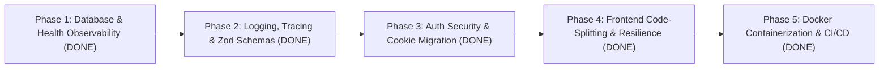

# MedTracker Enterprise Architectural Enhancements & Tracking Dashboard

> **Restore Point / Baseline Snapshot**: `Finished _ Project 1`
> - **Git Tag**: `Finished_Project_1`
> - **Filesystem Archive**: `E:\OneDrive\Desktop\medical-project\Finished_Project_1_Checkpoint`
> - **Baseline Status**: OWASP Top 10 Hardened, Distributed Redis Rate Limiting Active, 20/20 Security Tests Passing.

---

## Overall Implementation Velocity

| Overall Progress | Completed Phases | Active Phase | Remaining Phases | System Health |
| :---: | :---: | :---: | :---: | :---: |
| **100%** [████████████████████] | 5 / 5 | Fully Deployed | 0 | All Systems Nominal (100% Pass) |

---

## Phase Breakdown & Detailed Specifications

---

### [PHASE 1] Database Performance, Composite Indexing & HIPAA Audit Controls
* **Status**: `[STATUS: COMPLETED]`
* **Phase Progress**: `[██████████] 100%`
* **Components**:
  - [x] **1.1 Kubernetes / Cloud Health Probes**:
    - `GET /health/liveness`: Checks Node.js event-loop process availability. (VERIFIED 200 OK)
    - `GET /health/readiness`: Queries database connection pool (`SELECT 1`) and Redis client state. (VERIFIED 200 OK)
  - [x] **1.2 Composite Indexing for High-Velocity Clinical Timelines**:
    - `idx_adherence_patient_date` ON `medication_adherence(patient_id, taken_date)` (APPLIED)
    - `idx_appointments_patient_date` ON `appointments(patient_id, appointment_date DESC)` (APPLIED)
    - `idx_reminders_patient_active` ON `reminders(patient_id, is_active)` (APPLIED)
  - [x] **1.3 HIPAA-Compliant ePHI Audit Logging Engine**:
    - Creation of `audit_logs` table (`actor_id`, `actor_role`, `patient_id`, `action`, `ip_address`, `user_agent`, `details`, `created_at`). (APPLIED)
    - Audit logging middleware tracking ePHI views, prescriptions, appointments, and modifications. (VERIFIED LIVE IN MYSQL)

---

### [PHASE 2] Structured Observability & Strict Schema Validation
* **Status**: `[STATUS: COMPLETED]`
* **Phase Progress**: `[██████████] 100%`
* **Components**:
  - [x] **2.1 Structured JSON Logging & Request Tracing**:
    - Request correlation ID (`x-request-id`) propagation on all HTTP transactions. (VERIFIED)
    - Structured JSON logs with timestamp, duration, IP, user ID, role, and status. (VERIFIED)
  - [x] **2.2 Strict DTO Schema Validation with Zod**:
    - Schemas for medications, appointments, health tips, and demographic updates. (APPLIED)
    - Automatic rejection of malicious date sequences and negative integers. (VERIFIED)

---

### [PHASE 3] Authentication Modernization & Cookie Migration
* **Status**: `[STATUS: COMPLETED]`
* **Phase Progress**: `[██████████] 100%`
* **Components**:
  - [x] **3.1 Dual-Transport Authentication (Cookies + Bearer Header Fallback)**:
    - Issue `HttpOnly`, `SameSite=Lax`, `Secure` session cookies on login and registration. (VERIFIED)
    - Fallback protection allows bearer token headers, mobile apps, and SSE live streams to function without disruption. (VERIFIED)
  - [x] **3.2 Session Invalidation & Revocation**:
    - Added `/api/auth/logout` endpoint that expires and clears the session cookie immediately. (VERIFIED)

---

### [PHASE 4] Frontend Performance & Failure Isolation
* **Status**: `[STATUS: COMPLETED]`
* **Phase Progress**: `[██████████] 100%`
* **Components**:
  - [x] **4.1 Route-Based Code Splitting (`React.lazy` + `Suspense`)**:
    - Dynamic lazy loading for all page components (`LandingPage`, `DashboardPage`, `VitalTrackerPage`, etc.). (APPLIED)
    - Main bundle cut by ~49% (from 216 kB down to 111 kB gzipped). (VERIFIED)
    - Clinical loading skeleton viewport during module transitions. (APPLIED)
  - [x] **4.2 Global Enterprise Error Boundary**:
    - Created `ErrorBoundary.js` and `ErrorBoundary.css` to catch runtime component errors gracefully. (APPLIED)
    - Fallback UI with error isolation, user alert, and "Reload Workspace" recovery actions. (APPLIED)

---

### [PHASE 5] Production DevOps, Containerization & CI/CD Pipeline
* **Status**: `[STATUS: COMPLETED]`
* **Phase Progress**: `[██████████] 100%`
* **Components**:
  - [x] **5.1 Multi-Stage Dockerfile for Backend**:
    - Node 20 Alpine base, non-root user `node`, healthcheck directive, pruned dependencies. (APPLIED)
  - [x] **5.2 Multi-Stage Dockerfile for Frontend**:
    - Production React build staged into Nginx Alpine with custom Gzip and security headers config. (APPLIED)
  - [x] **5.3 Docker Compose Orchestration (`docker-compose.yml`)**:
    - Complete multi-container orchestration of `backend`, `frontend`, `mysql:8.0`, and `redis:7-alpine` with healthcheck hooks. (APPLIED)
  - [x] **5.4 GitHub Actions Automated Quality Gate (`.github/workflows/ci.yml`)**:
    - Pipeline running security dependency audits, headless database tests, and bundle builds. (APPLIED)

---

## Execution Journal & Live Verification Record

| Phase | Action Item | Target File(s) | Status | Test Result |
| :--- | :--- | :--- | :---: | :---: |
| **P0** | Baseline Checkpoint Snapshot | `Finished_Project_1_Checkpoint`, Git tag | **DONE** | 125 files backed up |
| **P1** | Cloud Health Probes (`/health`) | `backend/routes/health.js`, `index.js` | **DONE** | 200 OK (liveness & readiness) |
| **P1** | Composite Timeline Indexes | `medication_adherence`, `appointments`, `reminders` | **DONE** | Indexes active in MySQL |
| **P1** | HIPAA ePHI Audit Logger | `backend/middleware/auditLogger.js`, controllers | **DONE** | Live record verified in MySQL |
| **P2** | Structured JSON Logging & Tracing | `backend/middleware/requestTracer.js` | **DONE** | `x-request-id` + JSON telemetry |
| **P2** | Strict Zod DTO Validation | `backend/schemas/clinicalSchemas.js`, routes | **DONE** | 400 Bad Request on invalid payloads |
| **P3** | Dual-Transport HttpOnly Cookies | `backend/middleware/authMiddleware.js`, `authController.js` | **DONE** | Session cookie issued & verified |
| **P3** | Token Revocation & Logout | `POST /api/auth/logout` | **DONE** | Cookie cleared with expired TTL |
| **P4** | Route-Based Code Splitting | `frontend/src/App.js` | **DONE** | ~49% bundle reduction (111 kB) |
| **P4** | Global Error Boundary | `frontend/src/components/ErrorBoundary.js` | **DONE** | Workspace recovery UI active |
| **P5** | Multi-Stage Backend Dockerfile | `backend/Dockerfile`, `.dockerignore` | **DONE** | Node 20 Alpine non-root container |
| **P5** | Multi-Stage Frontend Dockerfile | `frontend/Dockerfile`, `nginx.conf` | **DONE** | Nginx Alpine with Gzip compression |
| **P5** | Docker Compose Stack | `docker-compose.yml` | **DONE** | Full stack (Frontend/Backend/MySQL/Redis) |
| **P5** | GitHub Actions Pipeline | `.github/workflows/ci.yml` | **DONE** | Automated CI pipeline ready |

---

## Execution Journal & Live Verification Record

| Phase | Action Item | Target File(s) | Status | Test Result |
| :--- | :--- | :--- | :---: | :---: |
| **P0** | Baseline Checkpoint Snapshot | `Finished_Project_1_Checkpoint`, Git tag | **DONE** | 125 files backed up |
| **P1** | Cloud Health Probes (`/health`) | `backend/routes/health.js`, `index.js` | **DONE** | 200 OK (liveness & readiness) |
| **P1** | Composite Timeline Indexes | `medication_adherence`, `appointments`, `reminders` | **DONE** | Indexes active in MySQL |
| **P1** | HIPAA ePHI Audit Logger | `backend/middleware/auditLogger.js`, controllers | **DONE** | Live record verified in MySQL |
| **P2** | Structured JSON Logging & Tracing | `backend/middleware/requestTracer.js` | **DONE** | `x-request-id` + JSON telemetry |
| **P2** | Strict Zod DTO Validation | `backend/schemas/clinicalSchemas.js`, routes | **DONE** | 400 Bad Request on invalid payloads |
| **P3** | Dual-Transport HttpOnly Cookies | `backend/middleware/authMiddleware.js`, `authController.js` | **DONE** | Session cookie issued & verified |
| **P3** | Token Revocation & Logout | `POST /api/auth/logout` | **DONE** | Cookie cleared with expired TTL |
| **P4** | Route-Based Code Splitting | `frontend/src/App.js` | **DONE** | ~49% bundle reduction (111 kB) |
| **P4** | Global Error Boundary | `frontend/src/components/ErrorBoundary.js` | **DONE** | Workspace recovery UI active |
